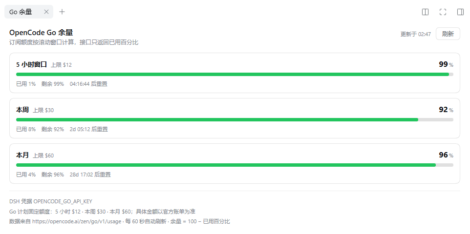

# dsh-opencode-go-quota

在 DeepSeek Harness 的**右侧边栏**看 **OpenCode Go** 订阅余量。



入口有两个，读的是同一份数据：

- **左侧栏底部的小圆环**：常驻图标，弧长 = 最紧的那个预算窗口的剩余比例
  （≥50% 绿、≥20% 橙、<20% 红）。鼠标移上去（或键盘聚焦）弹出卡片，一次看全
  5 小时 / 本周 / 本月三个窗口的剩余与重置倒计时；点一下打开右栏面板。
- **右侧边栏**打开后，在「开始」引导页点 **Go 余量** 卡片，标签页就钉在右栏上。

面板本身仍在右栏；左侧栏只有这个状态图标，不放面板入口。

## 面板内容

`Go 余量` 标签页里是三个预算窗口，各一条进度条：

| 窗口 | 上限 | 展示 |
|---|---|---|
| 5 小时（滚动） | $12 | 已用 / 剩余百分比、重置倒计时 |
| 本周 | $30 | 同上 |
| 本月 | $60 | 同上 |

进度条按压力变色（剩余 ≥50% 绿、≥20% 橙、<20% 红），右上角有「更新于 / 刷新」，底部写明密钥命中来源与数据来源。

## 数据从哪来

宿主端轮询 OpenCode Go 的官方用量接口：

```
GET https://opencode.ai/zen/go/v1/usage      Authorization: Bearer <opencode-go key>
→ { "usage": { "rolling": { "status": "ok", "percent": 1, "resetsAt": "…" },
               "weekly":  { … }, "monthly": { … } } }
```

接口只给 **status / percent / resetsAt**，没有美元金额也没有余额，所以面板展示的是
「剩余 = 100 − 已用百分比」，并注明 Go 计划的固定上限。

浏览器只拿宿主归一化后的快照（同源 `GET /api/opencode-go/usage`），**API key 永不进前端**。

## 密钥从哪来

按顺序取第一个可用的：

1. 配置项 `apiKey`
2. **DSH 自己的凭据库**（`ctx.credentials` 解析 `OPENCODE_GO_API_KEY` / `OPENCODE_API_KEY`）——
   如果 DSH 已经在用 `opencode-go` 当模型提供方，这里通常**零配置**直接可用
3. 环境变量 `OPENCODE_GO_API_KEY` / `OPENCODE_API_KEY`
4. OpenCode 自己的 `~/.local/share/opencode/auth.json`（`opencode-go` 条目）

面板底部写明实际命中的来源（例如 `DSH 凭据 OPENCODE_GO_API_KEY`）。

## 安装

会话内让代理安装，或 设置 → 插件 → 添加插件 → 选本目录：

- `plugin_manager` → `action: install_bundle` → `target: E:\project\dsh-plugin\dsh-opencode-go-quota`

手动方式（等效）：档案目录 `~/.dsh/profiles/<profile>/` 下

```powershell
pnpm add "link:E:/project/dsh-plugin/dsh-opencode-go-quota"
```

把 `dsh-opencode-go-quota` 加进同目录 `package.json` 的 `dsh.profile.bundles`。

## 配置（可选）

在档案的 `cordis.patch.yml` 里覆盖默认值：

```yaml
- id: opencode-go-quota
  name: 'dsh-opencode-go-quota'
  config:
    apiKey: 'sk-...'          # 不写则走 DSH 凭据 / 环境变量 / auth.json
    baseUrl: 'https://opencode.ai/zen/go/v1'
    cacheMs: 60000            # 上游样本复用时长
    timeoutMs: 15000
    limits:                   # 仅用于展示的固定额度
      rolling: 12
      weekly: 30
      monthly: 60
```

## 接口

`GET /api/opencode-go/usage`（同源，只读；`?refresh=1` 强制刷新）

```json
{
  "ok": true,
  "plan": "go",
  "limits": { "rolling": 12, "weekly": 30, "monthly": 60 },
  "windows": {
    "rolling": { "status": "ok", "percent": 1, "remainingPercent": 99, "resetsAt": "…" },
    "weekly":  { "status": "ok", "percent": 8, "remainingPercent": 92, "resetsAt": "…" },
    "monthly": { "status": "ok", "percent": 4, "remainingPercent": 96, "resetsAt": "…" }
  },
  "fetchedAt": "2026-11-07T02:47:00.000Z",
  "ageMs": 12345,
  "stale": false,
  "keySource": "credentials:OPENCODE_GO_API_KEY",
  "error": null
}
```

`error.code`：`no_key`、`unauthorized`、`network`、`timeout`、`http_<status>`、`bad_payload`。
上游失败时保留上一份窗口数据并置 `stale: true`，面板显示「旧数据」横幅而不是清零。

## 测试

```powershell
node --test test/host.test.mjs test/client.test.mjs
```

`host.test.mjs` 覆盖：两种上游报文形状、缓存复用、401 保留旧值、无 key、auth.json 读取、凭据库优先级、异常报文。
`client.test.mjs` 是客户端冒烟测试（React/DOM 打桩、不渲染像素）：两个界面都完成注册，圆环取「最紧」窗口的剩余比例，无数据时是灰色空环，点击接到右栏面板。

## 边界

- 只读百分比；**不**统计本地会话 token（那是 `dsh-token-usage-stats` 的事）。
- 面板走 `ui-sidebar-right` 的标签页体系（tab type + `sidebar.right.pane.tab`），
  并登记一张 `sidebar.right.tab.guide` 卡片作为入口；右侧服务通过 `ctx.inject` 等待就绪，本插件不依赖加载顺序。
- 图标挂在左栏底部的 `sidebar.footer.action`（list 槽，可与其他插件共存），所以面板/图标都不占用
  `shell.bottom`——那条状态栏已经被 `dsh-token-usage-stats` 占着。
- 悬停卡片用 `position: fixed` 定位，绕开侧栏的 `overflow`；`ensureStyle` 采用「就地更新」而不是
  「首个调用者生效」，否则热替换（HMR）后新样式进不来。
- `percent` 语义为「已用」，`remainingPercent` 是本插件算的 `100 - percent`。
